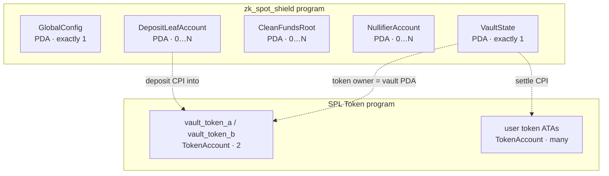
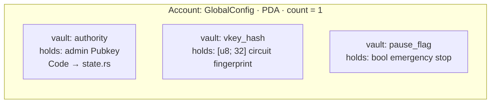
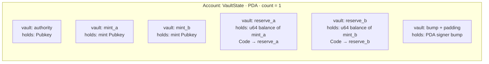
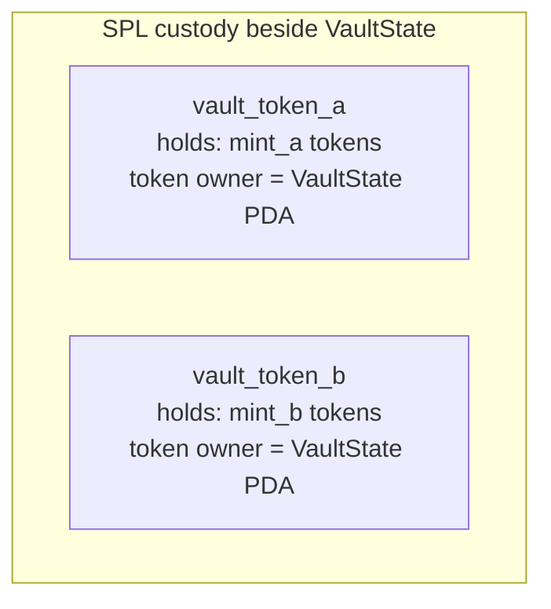
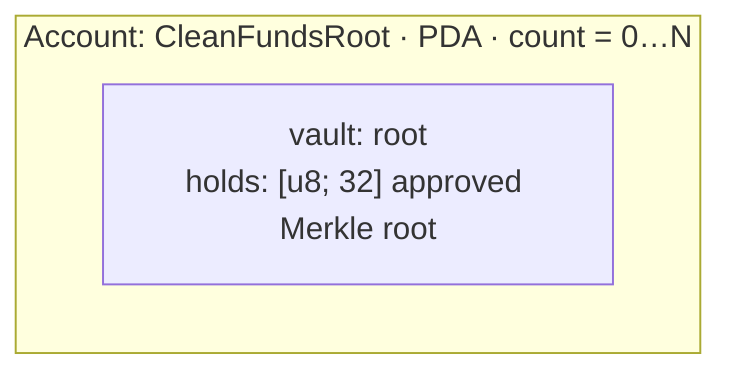
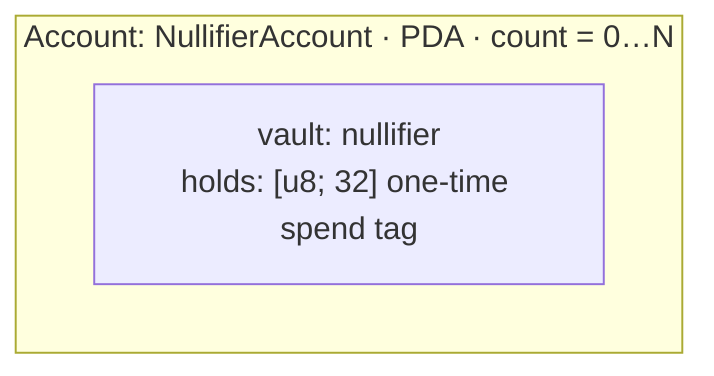
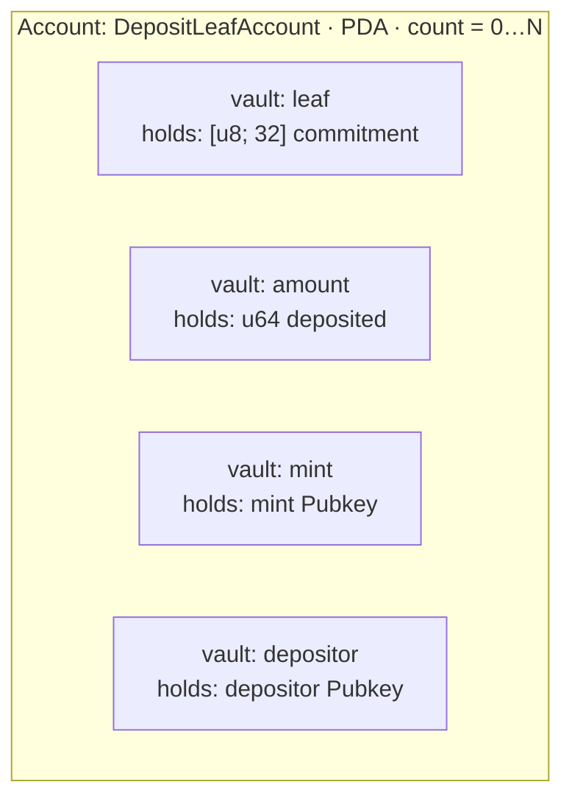

# Solana / Anchor components deep dive

How ZK Spot Shield’s on-chain pieces fit together: **what each account is for**, **type (PDA vs ATA)**, **who owns it vs who has authority**, **how many exist**, and **what lives inside** (fields / custody “vaults”).

!!! tip "Two kinds of “owner”"
    - **Program owner** — the Solana program allowed to *write* the account’s data bytes (after `init`, our PDAs are owned by `zk_spot_shield`).
    - **Authority** — a pubkey *stored in the data* (or an SPL token account’s `owner` field) that the program / Token program treats as allowed to act (pause, register roots, spend tokens).

    See also [Glossary: Owner, payer, authority](glossary.md).

**Legend for the diagrams**

| Label | Meaning |
| --- | --- |
| **Type** | `PDA` = Program Derived Address (no private key). `ATA` / SPL `TokenAccount` = token balance account (not our program’s data layout). |
| **Program owner** | Who may mutate data (our program, or the SPL Token program). |
| **Authority** | Who the *logic* treats as admin / spender. |
| **How many** | Cardinality on a live deployment. |
| **Code** | Markdown link labeled `Code` → first line of the Rust definition on `main`. |

---

## Map of program accounts

---

## Account cards (nested vaults / fields)

Each outer box is an **account**. Inner boxes are **what it holds** (state fields or related custody). Links jump to the definition on GitHub.

### `GlobalConfig` — admin / circuit pin / pause

| | |
| --- | --- |
| **For** | Trusted circuit fingerprint, pause switch, admin key |
| **Type** | PDA · seeds `["global-config"]` |
| **Program owner** | `zk_spot_shield` |
| **Authority** | `authority` pubkey in data (`has_one = authority` on pause / register root) |
| **How many** | **Exactly 1** |
| **Account** | [Code](https://github.com/pprogrammingg/zk-spot-shield/blob/main/programs/zk_spot_shield/src/state.rs#L18) |

Field defs: [Code](https://github.com/pprogrammingg/zk-spot-shield/blob/main/programs/zk_spot_shield/src/state.rs#L19) · Init: [Code](https://github.com/pprogrammingg/zk-spot-shield/blob/main/programs/zk_spot_shield/src/instructions/initialize_global_config.rs#L9)

---

### `VaultState` — spot reserves (hot path, zero-copy)

| | |
| --- | --- |
| **For** | 1:1 spot accounting for two mints; PDA signs payouts |
| **Type** | PDA · seeds `["spot_vault"]` · `AccountLoader` / zero-copy |
| **Program owner** | `zk_spot_shield` |
| **Authority** | `authority` in data (set at init); **signing authority for SPL** is the vault PDA itself (`bump`) |
| **How many** | **Exactly 1** |
| **Account** | [Code](https://github.com/pprogrammingg/zk-spot-shield/blob/main/programs/zk_spot_shield/src/state.rs#L27) |

Reserves: [reserve_a](https://github.com/pprogrammingg/zk-spot-shield/blob/main/programs/zk_spot_shield/src/state.rs#L31) · [reserve_b](https://github.com/pprogrammingg/zk-spot-shield/blob/main/programs/zk_spot_shield/src/state.rs#L32) · Init: [initialize_vault](https://github.com/pprogrammingg/zk-spot-shield/blob/main/programs/zk_spot_shield/src/instructions/initialize_vault.rs#L8)

!!! note "Accounting vs custody"
    `reserve_a` / `reserve_b` are **u64 counters inside** `VaultState`. The **tokens** sit in separate SPL accounts whose **token owner** is the vault PDA (next card). Settle updates both.

---

### Vault SPL token accounts — real token custody

| | |
| --- | --- |
| **For** | Hold mint A / B tokens the program moves on deposit & settle |
| **Type** | SPL `TokenAccount` (often an ATA); **not** a zk_spot_shield PDA layout |
| **Program owner** | SPL Token program |
| **Authority (spender)** | `owner` field = **vault PDA** (constraint in settle / deposit) |
| **How many** | **2** in the designed spot pair (one per mint); not unbounded |
| **Account (constraints)** | [Code](https://github.com/pprogrammingg/zk-spot-shield/blob/main/programs/zk_spot_shield/src/instructions/settle_shielded_spot.rs#L68) |

Deposit path: [vault_token](https://github.com/pprogrammingg/zk-spot-shield/blob/main/programs/zk_spot_shield/src/instructions/deposit_shielded.rs#L51)

---

### `CleanFundsRoot` — approved Merkle tip

| | |
| --- | --- |
| **For** | Allow-list a Merkle root so settle’s journal root is recognized |
| **Type** | PDA · seeds `["clean_funds_root", root]` |
| **Program owner** | `zk_spot_shield` |
| **Authority** | Created only by `GlobalConfig.authority` (register ix) |
| **How many** | **0…N** — one per registered root; grows with tree updates (no fixed cap in program) |
| **Account** | [Code](https://github.com/pprogrammingg/zk-spot-shield/blob/main/programs/zk_spot_shield/src/state.rs#L165) |

!!! quote "Unbounded “vaults”"
    There is only **one field vault** per account (`root`). Cardinality is **many accounts**, not many vaults inside one account — one account per approved tip forever (until you stop registering).

Register: [register_clean_funds_root](https://github.com/pprogrammingg/zk-spot-shield/blob/main/programs/zk_spot_shield/src/instructions/register_clean_funds_root.rs#L13)

---

### `NullifierAccount` — spent-note tag

| | |
| --- | --- |
| **For** | Double-spend lock: existence ⇒ this nullifier already settled |
| **Type** | PDA · seeds `["nullifier", nullifier]` |
| **Program owner** | `zk_spot_shield` |
| **Authority** | None in data; created on successful settle (payer funds rent) |
| **How many** | **0…N** — one per successful spend (unbounded over protocol life) |
| **Account** | [Code](https://github.com/pprogrammingg/zk-spot-shield/blob/main/programs/zk_spot_shield/src/state.rs#L136) |

Settle creates it after verify + transfers: [settle nullifier init](https://github.com/pprogrammingg/zk-spot-shield/blob/main/programs/zk_spot_shield/src/instructions/settle_shielded_spot.rs#L61)

---

### `DepositLeafAccount` — public deposit commitment

| | |
| --- | --- |
| **For** | Record a deposited leaf so the off-chain tree / proofs can use it |
| **Type** | PDA · seeds `["deposit_leaf", leaf]` |
| **Program owner** | `zk_spot_shield` |
| **Authority** | Depositor is recorded; creation signed by depositor as payer |
| **How many** | **0…N** — one per unique leaf (unbounded with deposits) |
| **Account** | [Code](https://github.com/pprogrammingg/zk-spot-shield/blob/main/programs/zk_spot_shield/src/state.rs#L110) |

Ix: [deposit_shielded](https://github.com/pprogrammingg/zk-spot-shield/blob/main/programs/zk_spot_shield/src/instructions/deposit_shielded.rs#L27)

---

### `Counter` — leftover sample (not settlement path)

| | |
| --- | --- |
| **For** | Early scaffold counter; not used by deposit/settle flows |
| **Type** | Ordinary Anchor account (if initialized) |
| **How many** | Optional / sample |
| **Account** | [Code](https://github.com/pprogrammingg/zk-spot-shield/blob/main/programs/zk_spot_shield/src/state.rs#L11) |

---

## Flow tables by scenario

### Happy path

| Account | Brief use case | Flows involved in |
| --- | --- | --- |
| `GlobalConfig` | Pin `vkey_hash`; pause off | `initialize_global_config` → later `settle_*` reads pause |
| `VaultState` | Move `reserve_*` 1:1 | `initialize_vault` → `deposit_shielded` → `settle_shielded_spot` |
| Vault SPL tokens | Custody mint A/B | deposit CPI in · settle CPI in/out |
| `CleanFundsRoot` | Prove journal root is approved | `register_clean_funds_root` → settle checks PDA exists |
| `DepositLeafAccount` | Publish leaf after deposit | `deposit_shielded` |
| `NullifierAccount` | Mark note spent | created at end of successful settle |
| User ATAs | User pays / receives | settle transfer legs |

### Pause / chaos (ops stop)

| Account | Brief use case | Flows involved in |
| --- | --- | --- |
| `GlobalConfig` | `pause_flag = true` | `pause` / `unpause` by authority |
| `VaultState` | Unchanged while paused | settle **refused** (`ProtocolPaused`) |
| `CleanFundsRoot` / nullifiers | Still readable | no new settles; register root still authority-gated |

### Bad actor

| Account | Brief use case | Flows involved in |
| --- | --- | --- |
| `NullifierAccount` | Replay same proof / nullifier | second settle → `NullifierAlreadyUsed` |
| `CleanFundsRoot` | Forge unregistered root | settle → `MerkleRootNotFound` (PDA missing) |
| `GlobalConfig` | Non-authority pause / register | `Unauthorized` via `has_one = authority` |
| Vault SPL | Wrong mint / wrong token owner | `InvalidTokenAccount` |
| Proof bytes | Garbage / wrong vkey | `InvalidProof` / verify fail |

### Not enough balance

| Account | Brief use case | Flows involved in |
| --- | --- | --- |
| `VaultState` | Pay leg larger than `reserve_*` | `apply_swap` → `VaultReserveUnderflow` |
| Vault SPL tokens | Token account empty vs accounting | SPL transfer fails / constraint fail |
| User ATA | User cannot fund deposit / pay leg | Token program insufficient funds |
| Circuit / journal | Prove spend above note balance | guest fail-closed (no valid proof) |

---

## Quick reference: seeds & sizes

| Account | Seeds | Data size (excl. 8-byte discriminator) |
| --- | --- | --- |
| `GlobalConfig` | `global-config` | 65 (`INIT_SPACE`) |
| `VaultState` | `spot_vault` | 120 |
| `DepositLeafAccount` | `deposit_leaf` + leaf | 104 |
| `NullifierAccount` | `nullifier` + nullifier | 32 |
| `CleanFundsRoot` | `clean_funds_root` + root | 32 |

Constants: [Code](https://github.com/pprogrammingg/zk-spot-shield/blob/main/programs/zk_spot_shield/src/constants.rs#L3)

For instruction-level narrative, see [Solana Program](solana-program.md).
