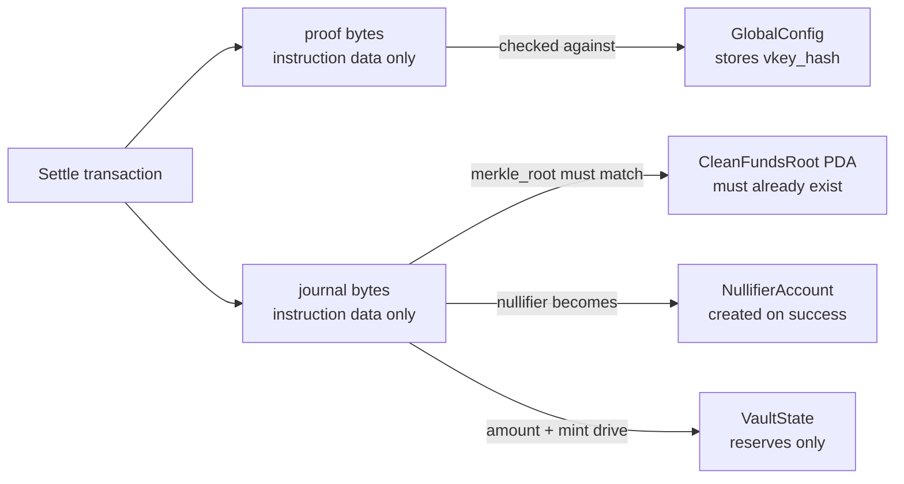
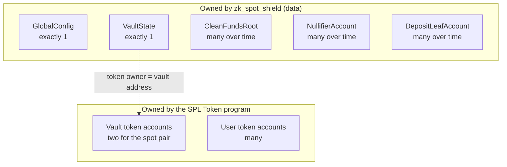
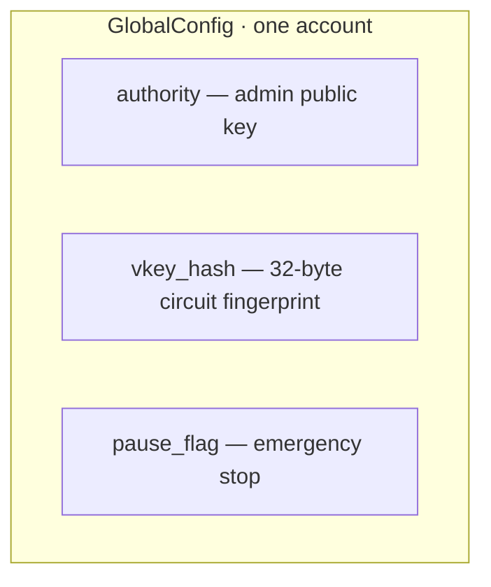
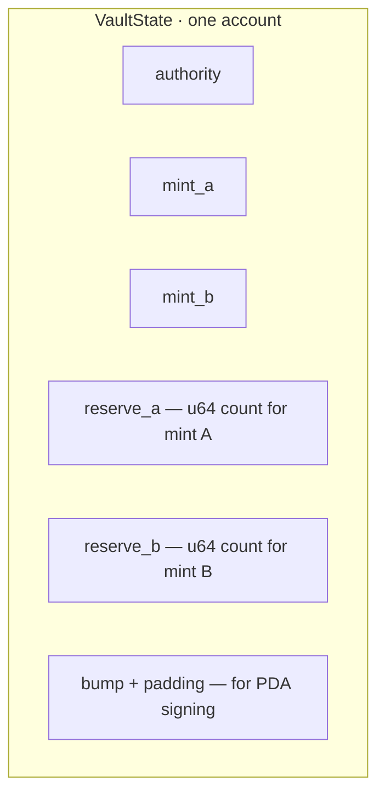
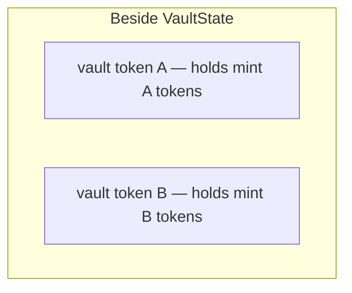
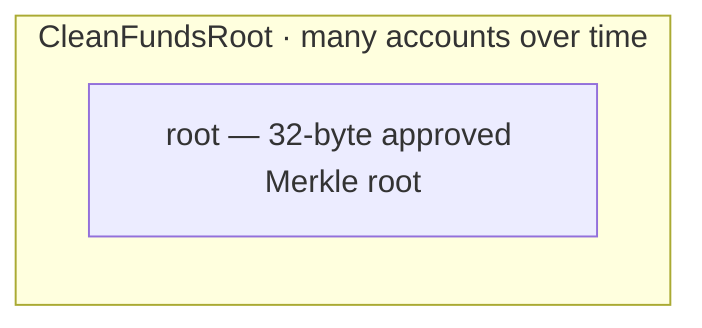
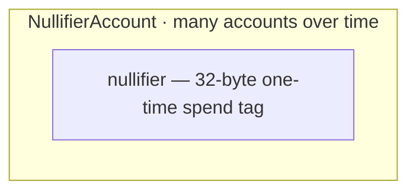
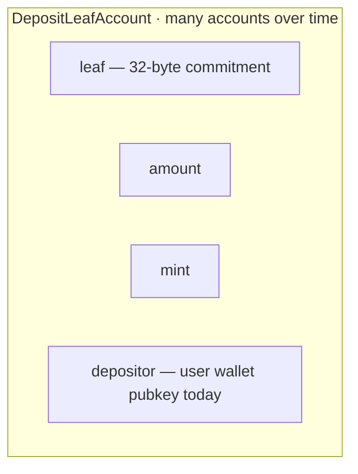

# Solana / Anchor components deep dive

This page walks through the on-chain pieces of ZK Spot Shield: what each account is for, how it is addressed, who can change it, how many of them exist, and what sits *inside* versus what only rides along in a transaction.

If a term is new, the [glossary](glossary.md) has a longer definition. The short versions you need here:

| Term | Plain meaning |
| --- | --- |
| **Account** | An address on Solana that holds lamports and a blob of data. |
| **Program-derived address (PDA)** | An address made from seeds + the program id. It has no private key; only our program can “sign” for it. |
| **Program owner** | The program allowed to rewrite an account’s *data* bytes. After we create a PDA, that owner is `zk_spot_shield`. |
| **Authority** | A public key stored *inside* the data (or on an SPL token account) that the code treats as admin or spender. Different job from program owner. |
| **SPL token account** | A balance of one mint, owned by the SPL Token program. The token account’s `owner` field is who may spend those tokens. |
| **Instruction data** | Bytes attached to a single transaction call (function args). They are **not** written into `VaultState` unless the handler copies something out into an account. |
| **Associated token account (ATA)** | A **standard address** for “this owner pubkey holds this mint.” Still an SPL token account. “ATA of the vault PDA” means owner = vault address, plus the mint. |
| **`ctx` / accounts list** | Only the accounts **this instruction** declared — not every PDA the program has ever created. |

SPL Token is a **program** (executable account), not “a kind of PDA.” Token balances live in token accounts owned by that program.

Numbered deposit → prove → settle journey: [Architecture](architecture.md).

---

## Where proofs and journals live (important)

Settle takes two big blobs as **instruction arguments**: `proof` and `journal`. They travel in the transaction. They are **not** fields on the vault.

| Blob | Stored on chain permanently? | Readable later from the vault? | What actually happens |
| --- | --- | --- | --- |
| **Groth16 proof bytes** | No. Only in the settle instruction for that one transaction. | No. `VaultState` never holds proofs. | Verifier runs in the handler; on success nothing copies the proof into an account. |
| **Journal (public values)** | Not as a whole blob. | No. | Parsed in-memory: amount, mint, nullifier, Merkle root. Root must match an existing `CleanFundsRoot`. Nullifier is then **written** into a new `NullifierAccount`. Amount/mint update vault **reserves** and drive token transfers. |
| **Verifying-key hash** | Yes — in `GlobalConfig.vkey_hash`. | N/A (not in the vault). | Proof must verify against this frozen fingerprint. |
| **Approved Merkle root** | Yes — one `CleanFundsRoot` account per root. | No (separate PDA). | Admin registers it before settle. |
| **Spent nullifier** | Yes — one `NullifierAccount` after a successful settle. | No (separate PDA). | Second settle with the same nullifier fails because the account already exists. |
| **Token balances** | Yes — in SPL token accounts. Accounting mirrors in `VaultState.reserve_a` / `reserve_b`. | Reserves are on the vault account; tokens are on the token accounts. | Both move together on deposit and settle. |

Handler signature: [Code](https://github.com/pprogrammingg/zk-spot-shield/blob/main/programs/zk_spot_shield/src/lib.rs#L48)

---

## Map of durable accounts

---

## Account cards

Each outer box is one account. Inner boxes are the **fields or custody pieces** it holds. **Code** links go to the first line of the Rust definition on `main`.

### GlobalConfig — admin, circuit pin, pause

One account for the whole deployment. Seeds: `["global-config"]`.

| | |
| --- | --- |
| **Purpose** | Remember who is admin, which circuit fingerprint is trusted, and whether settlement is paused |
| **Type** | Program-derived address |
| **Program owner** | `zk_spot_shield` |
| **Authority** | The `authority` public key stored in the account (must sign pause and root registration) |
| **How many** | Exactly one |
| **Definition** | [Code](https://github.com/pprogrammingg/zk-spot-shield/blob/main/programs/zk_spot_shield/src/state.rs#L18) |

Created by [initialize_global_config](https://github.com/pprogrammingg/zk-spot-shield/blob/main/programs/zk_spot_shield/src/instructions/initialize_global_config.rs#L9).

---

### VaultState — spot accounting (not the proof store)

One hot-path account. Seeds: `["spot_vault"]`. Loaded zero-copy so settlement does not copy the whole struct on every trade.

| | |
| --- | --- |
| **Purpose** | Track two mints and their reserve counters; hold the bump so the program can sign as this address |
| **Type** | Program-derived address |
| **Program owner** | `zk_spot_shield` |
| **Authority** | `authority` in data (set at init). For *moving tokens*, the vault address itself is the token authority (via the stored bump). |
| **How many** | Exactly one |
| **Definition** | [Code](https://github.com/pprogrammingg/zk-spot-shield/blob/main/programs/zk_spot_shield/src/state.rs#L27) |

Reserves: [reserve_a](https://github.com/pprogrammingg/zk-spot-shield/blob/main/programs/zk_spot_shield/src/state.rs#L31) · [reserve_b](https://github.com/pprogrammingg/zk-spot-shield/blob/main/programs/zk_spot_shield/src/state.rs#L32)

!!! note "What is not in this account"
    Proof bytes, the full journal, Merkle paths, and user secrets never live here. Only mints, reserve counters, authority, and bump.

---

### Vault token accounts — real token custody

These are ordinary SPL balances. The Token program owns the account data; the **spender** is the vault program-derived address.

| | |
| --- | --- |
| **Purpose** | Hold the actual mint A and mint B tokens |
| **Type** | SPL token account (often an associated token account) |
| **Program owner** | SPL Token program |
| **Authority (spender)** | Vault program-derived address |
| **How many** | Two for the designed spot pair (one per mint) |
| **Constraints in settle** | [Code](https://github.com/pprogrammingg/zk-spot-shield/blob/main/programs/zk_spot_shield/src/instructions/settle_shielded_spot.rs#L68) |

Deposit wires the destination token account here: [Code](https://github.com/pprogrammingg/zk-spot-shield/blob/main/programs/zk_spot_shield/src/instructions/deposit_shielded.rs#L51).

---

### CleanFundsRoot — “this Merkle root is approved”

| | |
| --- | --- |
| **Purpose** | Allow-list one Merkle root so a settle journal that cites it is accepted |
| **Type** | Program-derived address · seeds `["clean_funds_root", root]` |
| **Program owner** | `zk_spot_shield` |
| **Who may create it** | `GlobalConfig.authority` |
| **How many** | One account per registered root — grows over time; the program does not cap the count |
| **Definition** | [Code](https://github.com/pprogrammingg/zk-spot-shield/blob/main/programs/zk_spot_shield/src/state.rs#L165) |

Only one inner field. “Unbounded” means **many small accounts**, not infinite fields inside one account. Register: [Code](https://github.com/pprogrammingg/zk-spot-shield/blob/main/programs/zk_spot_shield/src/instructions/register_clean_funds_root.rs#L13).

---

### NullifierAccount — spent-note tag

| | |
| --- | --- |
| **Purpose** | Double-spend lock: if this account exists, that nullifier already settled |
| **Type** | Program-derived address · seeds `["nullifier", nullifier]` |
| **Program owner** | `zk_spot_shield` |
| **Authority in data** | None — existence is the lock |
| **How many** | One per successful spend — grows without a fixed program limit |
| **Definition** | [Code](https://github.com/pprogrammingg/zk-spot-shield/blob/main/programs/zk_spot_shield/src/state.rs#L136) |

Created after verify and transfers succeed: [Code](https://github.com/pprogrammingg/zk-spot-shield/blob/main/programs/zk_spot_shield/src/instructions/settle_shielded_spot.rs#L61).

---

### DepositLeafAccount — public deposit commitment

| | |
| --- | --- |
| **Purpose** | Record a leaf commitment after tokens are deposited, for the off-chain tree and later proofs |
| **Type** | Program-derived address · seeds `["deposit_leaf", leaf]` |
| **Program owner** | `zk_spot_shield` |
| **How many** | One per unique leaf — grows with deposits |
| **Definition** | [Code](https://github.com/pprogrammingg/zk-spot-shield/blob/main/programs/zk_spot_shield/src/state.rs#L110) |

**Why store the leaf hash?** The leaf hash is the **public commitment** to a private note. Storing it (and keying a PDA on it) does three jobs:

1. **Prove this deposit happened once.** Address = `PDA(["deposit_leaf", leaf])`. Creating it with `init` means the same leaf can’t be deposited twice — account already exists → fail.
2. **Give the off-chain tree something canonical to index.** Indexers / SDK see: “leaf X was deposited for amount Y / mint Z.” They insert X into the Merkle tree and later serve paths for proofs. Settle never re-reads every leaf PDA; it only checks a **registered root** + nullifier. The leaf PDAs are the public deposit log that feeds that tree.
3. **Bind public facts to the commitment.** Account data holds `leaf`, `amount`, `mint`, `depositor` so anyone can audit “this commitment was funded with this mint/amount” without seeing the **secret**.

**Why a hash, not the secret?** The leaf is `Poseidon(secret, …)` (commitment). On-chain you need a handle for the note that doesn’t reveal the secret. The hash is that handle.

**Redundancy note:** the leaf appears in both **seeds** and **account data**. Seeds make the address unique; the field makes the value easy to read from the account without reverse-engineering the address. Settle still doesn’t need to load this PDA to swap — it’s for deposit uniqueness + public record + tree sync, not for holding the Groth16 proof.

**Privacy caveat:** `depositor` is the **user’s wallet**. Deposit txs also show their token account. Shielding the spend secret ≠ hiding who funded the leaf. Unlinking deposit from withdraw is **(upcoming)** — see [Architecture](architecture.md) phase E.

**How the user spends later:** they keep the note (secret + balance + leaf) client-side; Thursday’s swap proves knowledge of that secret under a Merkle path — they do not “sign Monday’s deposit again.” See [Architecture](architecture.md).

Instruction: [Code](https://github.com/pprogrammingg/zk-spot-shield/blob/main/programs/zk_spot_shield/src/instructions/deposit_shielded.rs#L27).

---

### Counter — leftover sample

Early scaffold only. It is **not** on the deposit or settle path. Definition: [Code](https://github.com/pprogrammingg/zk-spot-shield/blob/main/programs/zk_spot_shield/src/state.rs#L11).

---

## Scenarios

Each table lists the durable accounts involved, and a short note on **where the flow-specific blobs sit**.

### Happy path

Someone deposits, an admin registers the tree tip, then a settle with a valid proof succeeds.

| Account | Role in this flow | Where the sensitive blobs are |
| --- | --- | --- |
| `GlobalConfig` | Pause off; `vkey_hash` used to verify | Proof is only in the settle instruction; checked against this hash, then discarded |
| `VaultState` | Reserves updated 1:1 for the trade | Journal amount/mint are instruction bytes; only the resulting reserve numbers are written here |
| Vault token accounts | Deposit already moved custody in; settle moves again on today’s wallet legs | Balances via Token program; not proof storage |
| `CleanFundsRoot` | Must already exist for the journal’s Merkle root | Root value lives in this PDA (registered earlier), not copied from the vault |
| `DepositLeafAccount` | Created at deposit time | Leaf/amount/mint/**depositor** stored here after deposit |
| `NullifierAccount` | Created at the end of settle | Nullifier taken from the journal and written into this new PDA |
| User token accounts | **Today:** settle still pulls journal mint from payer ATAs and pays the other mint out | Ordinary SPL balances |

!!! warning "Deposit vs settle custody today"
    After deposit, mint A already sits in the **vault’s token ATA**. Product intuition says settle should only spend that shielded claim. **Current** `settle_shielded_spot` still does user→vault for the journal mint plus vault→user for the other mint (ZK gate + 1:1 swap). Vault-only shielded spend is **(upcoming)**.

### Pause / ops stop

Admin sets `pause_flag`. Settles must fail closed until unpaused.

| Account | Role in this flow | Where the blobs are |
| --- | --- | --- |
| `GlobalConfig` | `pause_flag = true` | No proof is stored; settle reads this flag and returns `ProtocolPaused` before useful work |
| `VaultState` | Left unchanged | A paused settle does not rewrite reserves |
| `CleanFundsRoot` / nullifiers | Still readable on chain | Registering a new root still needs the admin; new settles do not run |

### Bad actor

| Attack idea | What they send | What the chain does | Where data lives |
| --- | --- | --- | --- |
| Replay the same spend | Same proof + journal again | Second settle sees a non-empty nullifier PDA → `NullifierAlreadyUsed` | Proof still only in the tx; the **nullifier account** is the durable lock |
| Cite an unknown Merkle root | Journal root with no `CleanFundsRoot` | Account constraints / lookup fail (`MerkleRootNotFound` or missing PDA) | Root was never written on chain; vault is irrelevant |
| Pause or register without admin | Wrong signer | `Unauthorized` via `has_one = authority` | Only `GlobalConfig.authority` matters |
| Point settle at the wrong token accounts | Mismatched mint or token owner | `InvalidTokenAccount` | Token accounts are separate from `VaultState` |
| Garbage or wrong-circuit proof | Bad `proof` bytes | Verify fails → `InvalidProof` | Bytes never land in the vault; verification is ephemeral |

### Not enough balance

| Failure mode | What runs out | Durable state | Blobs |
| --- | --- | --- | --- |
| Vault cannot pay the other mint | `reserve_*` too small | `apply_swap` fails with `VaultReserveUnderflow`; no nullifier account created | Journal still only in the instruction |
| Vault token account empty vs reserves | SPL transfer fails | Accounting should match custody; a mismatch fails the transfer | No proof storage |
| User cannot fund a deposit or pay leg | User token account balance | Token program rejects the transfer | Deposit leaf is not created if deposit fails |
| Note balance too low in the circuit | Private inputs invalid | Guest fails closed → **no proof** to submit | Nothing reaches the vault |

---

## Quick reference: seeds and sizes

Data sizes below exclude Anchor’s 8-byte account type tag.

| Account | Seeds | Data size |
| --- | --- | --- |
| `GlobalConfig` | `global-config` | 65 bytes |
| `VaultState` | `spot_vault` | 120 bytes |
| `DepositLeafAccount` | `deposit_leaf` + leaf | 104 bytes |
| `NullifierAccount` | `nullifier` + nullifier | 32 bytes |
| `CleanFundsRoot` | `clean_funds_root` + root | 32 bytes |

Seed constants: [Code](https://github.com/pprogrammingg/zk-spot-shield/blob/main/programs/zk_spot_shield/src/constants.rs#L3)

For the instruction-by-instruction story, see [Solana Program](solana-program.md). For the numbered end-to-end journey, see [Architecture](architecture.md).
