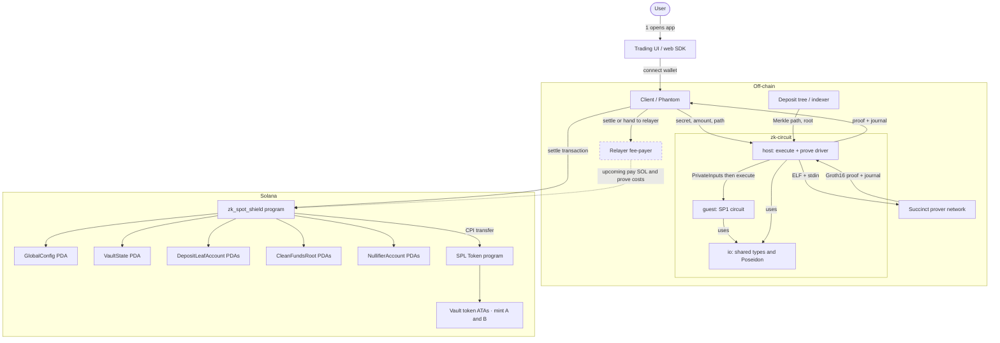
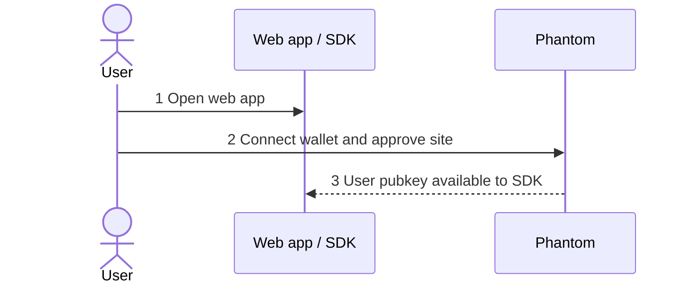
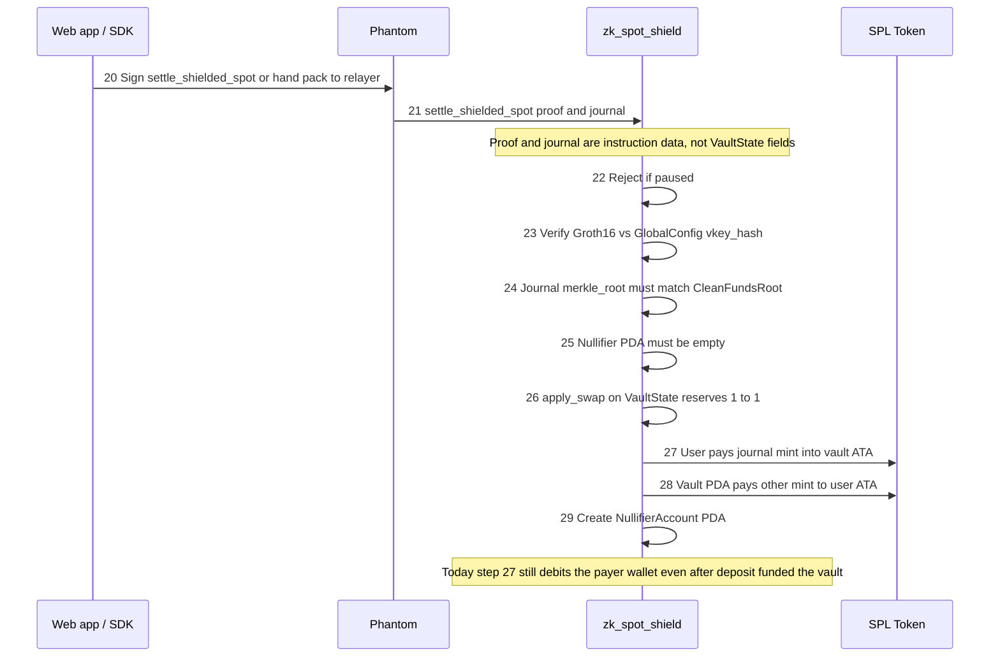
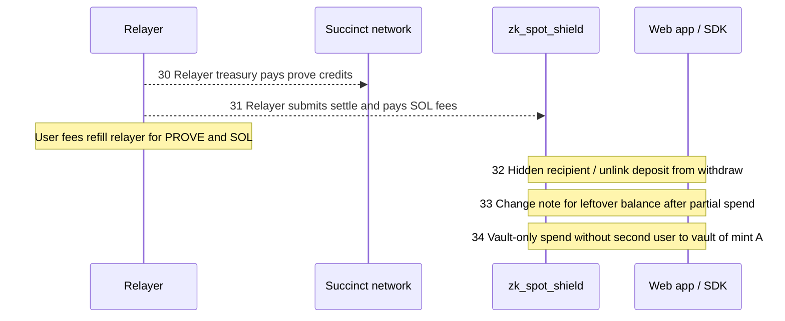
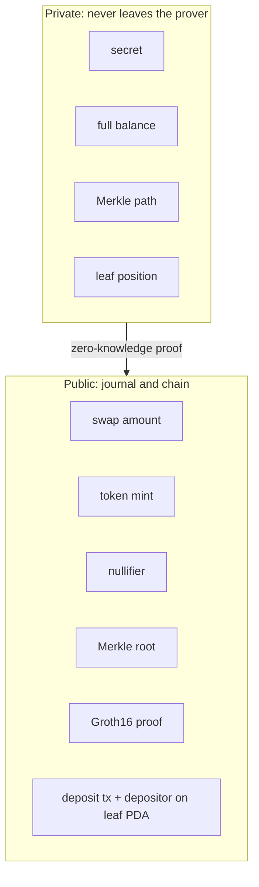

# Architecture

The system has three parts. The **client** holds the user's secret note. The **ZK circuit** turns private data into a proof. The **Solana program** checks the proof and settles.

Dotted boxes and arrows are **(upcoming)** product direction — not shipped yet. Solid ones exist in the repo today.

## Components



## Numbered product flow

Swap economics today are **1:1 spot** (journal `amount` of mint A ↔ same `amount` of mint B). An AMM-style “100 A for 50 B” curve is **(upcoming)**.

What the chain learns on settle: **amount**, **asset mint**, **nullifier**, **Merkle root**. What stays private in the proof: **secret**, **full note balance**, **Merkle path / leaf index**.

Step numbers **continue across phases** (1 → …). Each phase is its own diagram so the docs site can render them. Dotted arrows in phase E are **(upcoming)**.

| Phase | Steps | Status |
| --- | --- | --- |
| **A** Connect | 1–3 | UI polish **(upcoming)** |
| **B** Deposit | 4–12 | On-chain **built**; hosted indexer **(upcoming)** |
| **C** Prove | 13–19 | **Built** |
| **D** Settle today | 20–29 | **Built** (wallet legs for journal mint) |
| **E** Upcoming | 30–34 | **(upcoming)** |

### Phase A — Connect (steps 1–3)



### Phase B — Deposit (steps 4–12)

```mermaid
sequenceDiagram
    actor U as User
    participant W as Web app / SDK
    participant Ph as Phantom
    participant Prog as zk_spot_shield
    participant Spl as SPL Token
    participant Tree as Deposit tree

    U->>W: 4 Pick mint A and amount e.g. 300
    W->>W: 5 Create note secret; leaf equals Poseidon commitment
    W->>Ph: 6 Sign deposit_shielded
    Ph->>Prog: 7 deposit_shielded leaf and amount
    Prog->>Spl: 8 CPI user ATA to vault ATA for mint A
    Prog->>Prog: 9 Init DepositLeafAccount PDA
    Prog->>Prog: 10 Bump VaultState reserve
    Note over Prog: Leaf PDA holds leaf, amount, mint, depositor. Depositor is visible today.
    Prog-->>Tree: 11 Indexer inserts leaf into deposit tree
    Tree-->>Prog: 12 Authority register_clean_funds_root for tip
    Note over Tree,Prog: CleanFundsRoot PDA is the approved Merkle root fingerprint
```

### Phase C — Prove (steps 13–19)

```mermaid
sequenceDiagram
    actor U as User
    participant W as Web app / SDK
    participant Tree as Deposit tree
    participant Host as ZK host
    participant Net as Succinct network

    U->>W: 13 Choose shield swap amount of A for B at 1 to 1
    W->>Tree: 14 Fetch Merkle path under a registered root
    Tree-->>W: 15 Path and root
    W->>Host: 16 Witness secret, balance, amount, mint, path, root
    Host->>Host: 17 Cheap execute guest; fail closed if invalid
    Host->>Net: 18 Request Groth16 wrap
    Net-->>Host: Groth16 proof and journal
    Host-->>W: 19 Proof and journal ready for settle
```

### Phase D — Settle today (steps 20–29)



### Phase E — Upcoming (steps 30–34)



## What stays private



Deposit today still links a **wallet** to a leaf on-chain. Settle hides the secret and leaf index, but the settle transaction still lists **token accounts** (and often the fee payer). Full unlink is **(upcoming)**.

## Repository layout

| Folder | Role |
| --- | --- |
| `programs/zk_spot_shield/` | Anchor program `zk_spot_shield` (on-chain) |
| `zk-circuit/io/` | Shared input/output types and Poseidon Merkle helpers |
| `zk-circuit/guest/` | SP1 guest circuit |
| `zk-circuit/host/` | Host: execute and/or request a proof |
| `zk-circuit/fixtures/happy/` | Recorded Groth16 proof, journal, and verifying key |
| `client/` | Rust CU / ALT helpers |
| `relayer/` | Axum fee-payer scaffold (`/health`, `/submit-proof` queue) |
| `sdk/` | TypeScript Anchor provider, Merkle helpers, settle bridge |

See [Accounts deep dive](accounts-deep-dive.md) for PDA vs ATA vs instruction data, and [Solana Program](solana-program.md) for instruction semantics. See [Security](security.md) for the attack-surface table.
