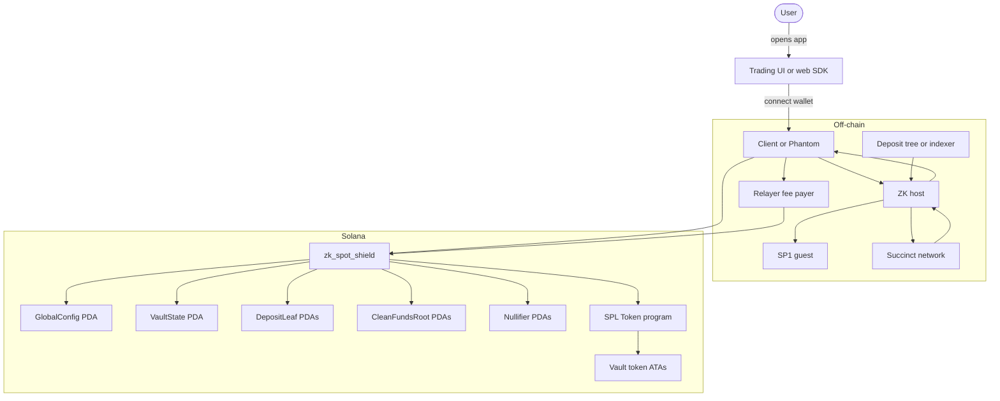
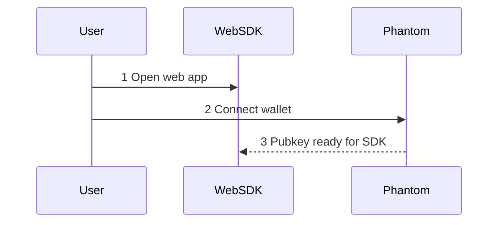
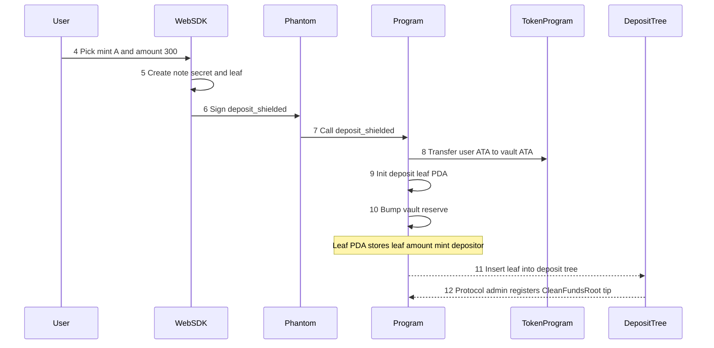
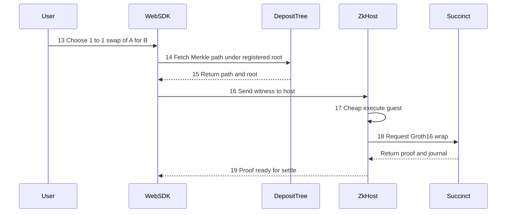
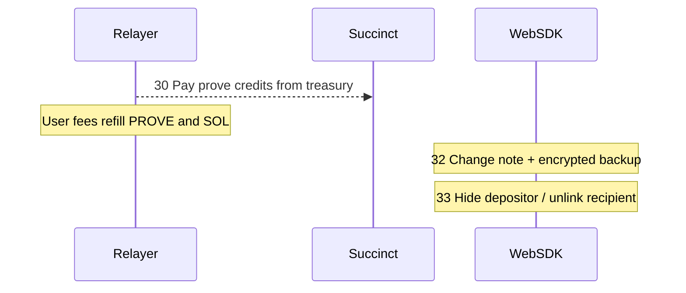
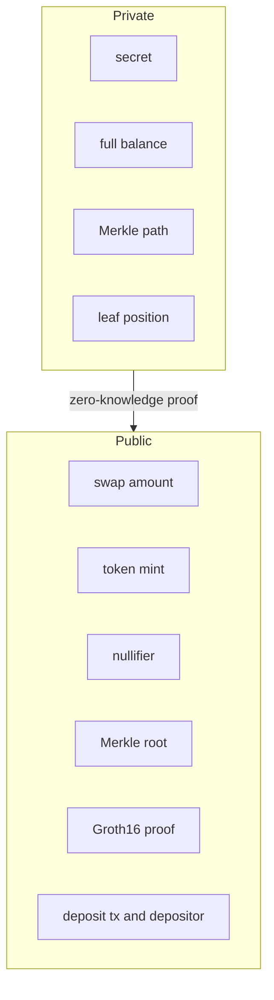

# Architecture

The system has three parts. The **client** holds the user's secret note. The **ZK circuit** turns private data into a proof. The **Solana program** checks the proof and settles.

**Protocol admin** is the admin pubkey on `GlobalConfig` (Rust field `authority`). That wallet may pause settle, register Merkle tips, and set vault mints once. It is not the vault PDA and not the SPL token spender.

## Components



## Numbered product flow

Swap economics today are **1:1 spot**. An AMM-style curve is **(upcoming)**.

On settle the chain learns **amount**, **asset mint**, **nullifier**, and **Merkle root**. The proof keeps private: **secret**, **full note balance**, and **Merkle path / leaf index**.

Each phase is a separate diagram so GitHub Pages can render them.

| Phase | Steps | Status |
| --- | --- | --- |
| **A** Connect | 1 to 3 | Built (`ui/` + SDK); polish later |
| **B** Deposit | 4 to 12 | Built on-chain; hosted indexer later |
| **C** Prove | 13 to 19 | Built |
| **D** Settle | 20 to 28 | Built: vault-only; fee payer may be a relayer |
| **E** Leftovers | 30 to 33 | Prove treasury; change notes + backup; then hide/unlink depositor |

---

### Phase A — Connect (steps 1 to 3)



---

### Phase B — Deposit (steps 4 to 12)



---

### Phase C — Prove (steps 13 to 19)



---

### Phase D — Settle today (steps 20 to 28)

Fee payer may be a relayer (not the note owner). Settle is **vault-only**: no second user→vault of the journal mint.

```mermaid
sequenceDiagram
 participant W as WebSDK
 participant Ph as Phantom
 participant Prog as Program
 participant Spl as TokenProgram
 W->>Ph: 20 Sign settle or hand to relayer
 Ph->>Prog: 21 settle_shielded_spot
 Note over Prog: proof and journal are ix data not vault fields
 Prog->>Prog: 22 Reject if paused
 Prog->>Prog: 23 Verify Groth16 vs vkey_hash
 Prog->>Prog: 24 Root must match CleanFundsRoot
 Prog->>Prog: 25 Nullifier PDA must be empty
 Prog->>Prog: 26 apply_vault_only_spend pay other mint
 Prog->>Spl: 27 Vault pays other mint to user
 Prog->>Prog: 28 Create nullifier PDA
 Note over Prog: Fee payer pays SOL rent; no second debit of journal mint
```

---

### Phase E — Upcoming (steps 30 to 33)

Fee-payer settle already works in phase D (self-submit or relayer). Still to build:



---

## What stays private



Deposit today still links a **wallet** to a leaf on-chain. Settle hides the secret and leaf index, but the settle transaction still lists **token accounts** and often the fee payer. Hide/unlink depositor is upcoming (after note backup).

See [Solana Program](solana-program.md) for accounts, instruction data vs state, and settle scenarios. See [Security](security.md) for the attack table. Folder map: [README](https://github.com/pprogrammingg/zk-spot-shield#repository).
