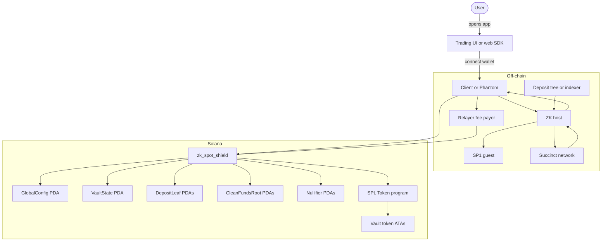
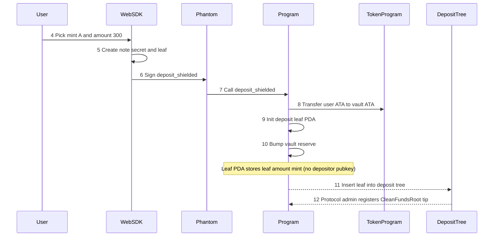
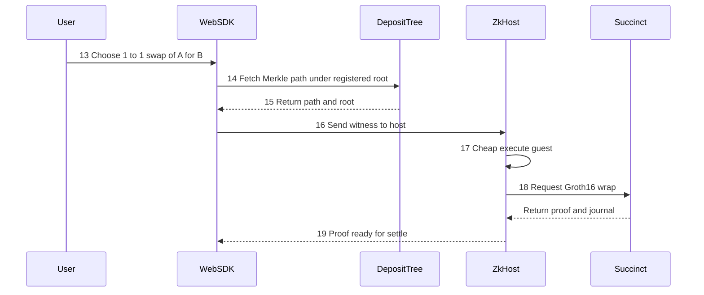
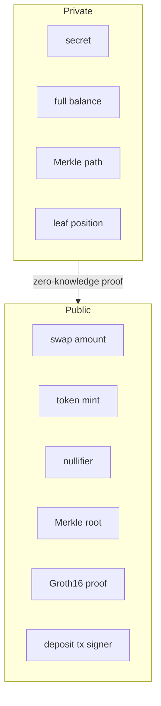

# Architecture

The system has three parts. The **client** holds the user's secret note. The **ZK circuit** turns private data into a proof. The **Solana program** checks the proof and settles.

**Protocol admin** is the admin pubkey on `GlobalConfig` (Rust field `authority`). That wallet may pause settle, register Merkle tips, and set vault mints once. It is not the vault PDA and not the SPL token spender.

## Components



## Numbered product flow

Swap economics today are **1:1 spot**. An AMM-style curve is **(upcoming)**.

On settle the chain learns **amount**, **asset mint**, **nullifier**, and **Merkle root**. The proof keeps private: **secret**, **full note balance**, and **Merkle path / leaf index**.

Each phase is a separate diagram so GitHub Pages can render them.

| Phase | Steps | Status |
| --- | --- | --- |
| **A** Connect | 1 to 3 | Built (`ui/` + SDK). Localnet | Devnet toggle (`?cluster=`). Localnet demo pack is the 144-byte happy proof. Both clusters poll the agent (`GET /status`, 4s, no RPC) for ATAs and teal notes. Vault/user balances poll Solana (Devnet 15s / localnet 8s). Agent syncs nullifiers at boot, before buy, and every 60s. A buy in flight paints the chosen note orange (**Locked for Spending ....**); spent notes grey out. UI balances are on-chain whole units. UI deposit + buy POST to the agent loopback (`127.0.0.1:8790`), not the relayer |
| **B** Deposit | 4 to 12 | Built on-chain; hosted indexer later |
| **C** Prove | 13 to 19 | Built |
| **D** Settle | 20 to 28 | Built: vault-only; fee payer may be a relayer |
| **E** Leftovers | 30 to 33 | Change notes + encrypted backup + unlink depositor from the leaf PDA; prove treasury still later. Relayer is the 402 merchant (terminal banners: quote vs journal vs nullifier; no wallet on the receipt) |

---

### Phase A — Connect (steps 1 to 3)

```mermaid
sequenceDiagram
 participant U as User
 participant W as WebSDK
 participant Ph as Phantom
 U->>W: 1 Open web app or agent CLI
 U->>Ph: 2 Connect wallet
 Ph-->>W: 3 Pubkey ready for SDK (deposit + SOL; notes stay with the agent)
```

---

### Phase B — Deposit (steps 4 to 12)



---

### Phase C — Prove (steps 13 to 19)



---

### Phase D — Settle today (steps 20 to 28)

Fee payer may be a relayer (not the note owner). Settle is **vault-only**: no second user→vault of the journal mint.

```mermaid
sequenceDiagram
 participant W as WebSDK
 participant Ph as Phantom
 participant Prog as Program
 participant Spl as TokenProgram
 W->>Ph: 20 Sign settle or hand to relayer
 Ph->>Prog: 21 settle_shielded_spot
 Note over Prog: proof and journal are ix data not vault fields
 Prog->>Prog: 22 Reject if paused
 Prog->>Prog: 23 Verify Groth16 vs vkey_hash
 Prog->>Prog: 24 Root must match CleanFundsRoot
 Prog->>Prog: 25 Nullifier PDA must be empty
 Prog->>Prog: 26 apply_vault_only_spend pay other mint
 Prog->>Spl: 27 Vault pays other mint to user
 Prog->>Prog: 28 Create nullifier PDA
 Prog->>Prog: 28b Insert change-leaf PDA if journal binds remainder
 Note over Prog: Fee payer pays SOL rent; no second debit of journal mint; admin still registers the new tip
```

---

### Phase E — Change notes, backup, unlink (steps 30 to 33)

Fee-payer settle already works in phase D (self-submit or relayer). Change notes, encrypted backup, and omitting the depositor from the leaf PDA are in the client/circuit/program. The toy Groth16 pack is 144 bytes (spend 100 / keep 900); settle inserts the remainder leaf PDA. Prove-treasury remains later.

```mermaid
sequenceDiagram
 participant Rel as Relayer
 participant Net as Succinct
 participant W as WebSDK
 Rel-->>Net: 30 Pay prove credits from treasury
 Note over Rel: User fees refill PROVE and SOL
 Note over W: 32 Change note + encrypted backup
 Note over W: 33 Leaf PDA has no depositor; payout ATA may be wallet R
```

---

## What stays private



The leaf PDA no longer stores a depositor pubkey. The **deposit transaction** still shows signer D and the SPL transfer. Settle hides the secret and leaf index, but the settle transaction still lists **token accounts** and often the fee payer. Default unlink path: deposit from wallet D, pay wallet R.

See [Solana Program](solana-program.md) for accounts, instruction data vs state, and settle scenarios. See [Security](security.md) for the attack table. Folder map: [README](https://github.com/pprogrammingg/zk-spot-shield#repository).
