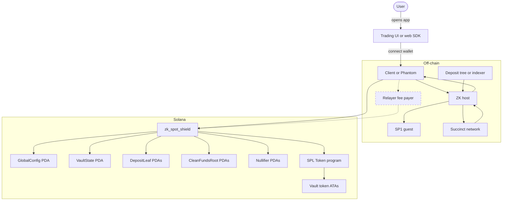
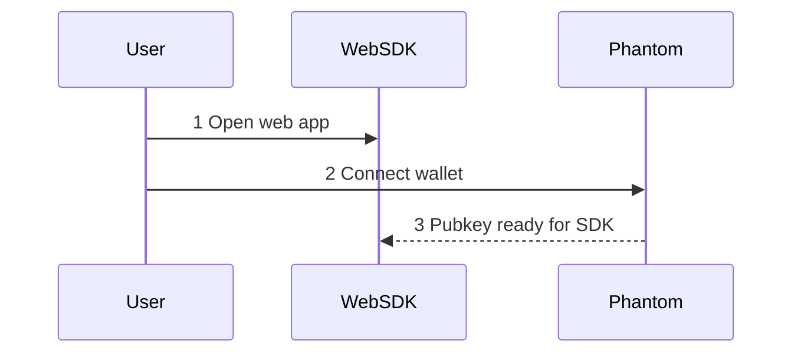
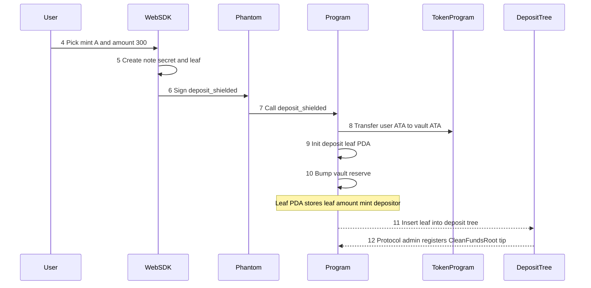
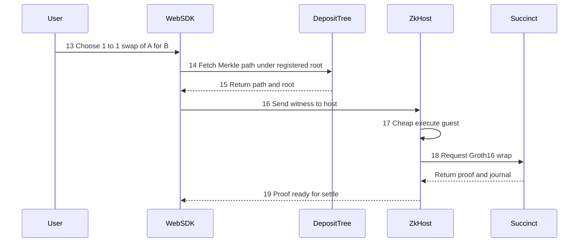
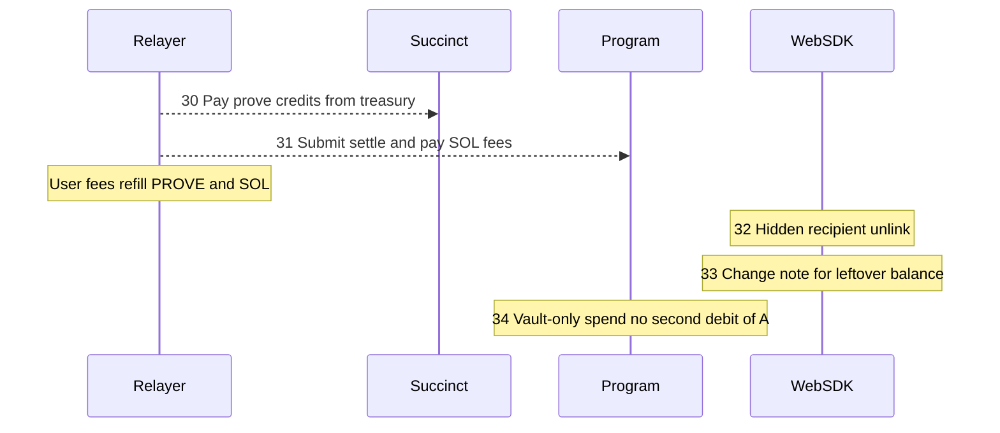
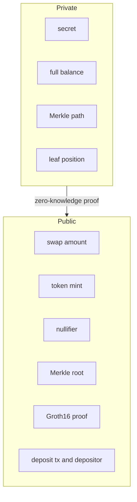

# Architecture

The system has three parts. The **client** holds the user's secret note. The **ZK circuit** turns private data into a proof. The **Solana program** checks the proof and settles.

Dotted boxes and arrows are **(upcoming)** product direction — not shipped yet. Solid ones exist in the repo today.

**Protocol admin** means the admin pubkey stored on `GlobalConfig` (Rust field `authority`). That wallet may pause settle and register Merkle tips. It is not the vault PDA and not the SPL token spender.

## Components



## Numbered product flow

Swap economics today are **1:1 spot**. An AMM-style curve is **(upcoming)**.

On settle the chain learns **amount**, **asset mint**, **nullifier**, and **Merkle root**. The proof keeps private: **secret**, **full note balance**, and **Merkle path / leaf index**.

Step numbers **continue across phases**. Each phase is a **separate** Mermaid diagram below (blank space between them) so GitHub Pages can render them.

| Phase | Steps | Status |
| --- | --- | --- |
| **A** Connect | 1 to 3 | UI polish upcoming |
| **B** Deposit | 4 to 12 | Built on-chain; hosted indexer upcoming |
| **C** Prove | 13 to 19 | Built |
| **D** Settle today | 20 to 28 | Built; vault-only spend (Day 48); fee payer ≠ note owner (Day 46) |
| **E** Relayer ops | 30 to 34 | Scaffold + fee stub (44–47); prove treasury / unlink / change notes upcoming |

---

### Phase A — Connect (steps 1 to 3)



---

### Phase B — Deposit (steps 4 to 12)



---

### Phase C — Prove (steps 13 to 19)



---

### Phase D — Settle today (steps 20 to 28)

Days **46–48**: fee payer may be a relayer (≠ note owner); settle is **vault-only** (no second user→vault of the journal mint).

```mermaid
sequenceDiagram
  participant W as WebSDK
  participant Ph as Phantom
  participant Prog as Program
  participant Spl as TokenProgram
  W->>Ph: 20 Sign settle or hand to relayer
  Ph->>Prog: 21 settle_shielded_spot
  Note over Prog: proof and journal are ix data not vault fields
  Prog->>Prog: 22 Reject if paused
  Prog->>Prog: 23 Verify Groth16 vs vkey_hash
  Prog->>Prog: 24 Root must match CleanFundsRoot
  Prog->>Prog: 25 Nullifier PDA must be empty
  Prog->>Prog: 26 apply_vault_only_spend pay other mint
  Prog->>Spl: 27 Vault pays other mint to user
  Prog->>Prog: 28 Create nullifier PDA
  Note over Prog: Fee payer pays SOL rent; no second debit of journal mint
```

---

### Phase E — Upcoming (steps 30 to 34)



---

## What stays private



Deposit today still links a **wallet** to a leaf on-chain. Settle hides the secret and leaf index, but the settle transaction still lists **token accounts** and often the fee payer. Full unlink is **(upcoming)**.

## Repository layout

| Folder | Role |
| --- | --- |
| `programs/zk_spot_shield/` | Anchor program `zk_spot_shield` (on-chain) |
| `zk-circuit/io/` | Shared input/output types and Poseidon Merkle helpers |
| `zk-circuit/guest/` | SP1 guest circuit |
| `zk-circuit/host/` | Host: execute and/or request a proof |
| `zk-circuit/fixtures/happy/` | Recorded Groth16 proof, journal, and verifying key |
| `client/` | Rust CU / ALT helpers |
| `relayer/` | Axum fee-payer scaffold |
| `sdk/` | TypeScript Anchor provider, Merkle helpers, settle bridge |

See [Accounts deep dive](accounts-deep-dive.md) for PDA vs ATA vs instruction data, and [Solana Program](solana-program.md) for instruction semantics. See [Security](security.md) for the attack-surface table.
