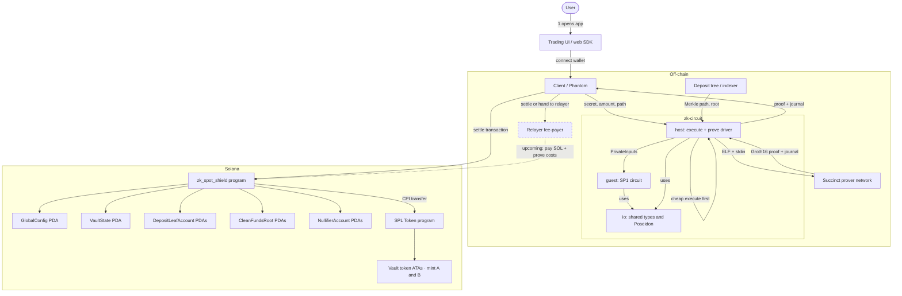
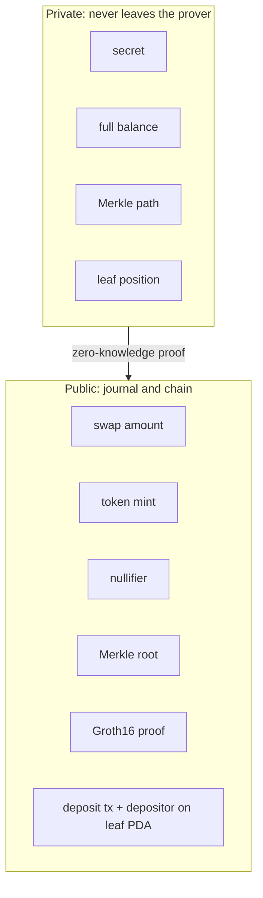

# Architecture

The system has three parts. The **client** holds the user's secret note. The **ZK circuit** turns private data into a proof. The **Solana program** checks the proof and settles.

Dotted boxes and arrows are **(upcoming)** product direction — not shipped yet. Solid ones exist in the repo today.

## Components



## Numbered product flow

Swap economics today are **1:1 spot** (journal `amount` of mint A ↔ same `amount` of mint B). An AMM-style “100 A for 50 B” curve is **(upcoming)**.

What the chain learns on settle: **amount**, **asset mint**, **nullifier**, **Merkle root**. What stays private in the proof: **secret**, **full note balance**, **Merkle path / leaf index**.

### Sequence (numbers match the notes)

```mermaid
sequenceDiagram
    autonumber
    actor U as User
    participant W as Web app / SDK
    participant Ph as Phantom wallet
    participant Spl as SPL Token
    participant Prog as zk_spot_shield
    participant Tree as Deposit tree / indexer
    participant Host as ZK host
    participant Net as Succinct network
    participant Rel as Relayer

    Note over U,Rel: A — Connect
    U->>W: Open spot.shield-style web app
    U->>Ph: Connect wallet and approve site
    Ph-->>W: User pubkey available to SDK

    Note over U,Rel: B — Deposit (built)
    U->>W: Pick mint A, amount e.g. 300, confirm
    W->>W: Create note secret; leaf = Poseidon commitment
    W->>Ph: Sign deposit_shielded tx
    Ph->>Prog: deposit_shielded(leaf, amount)
    Prog->>Spl: CPI transfer user ATA → vault ATA for mint A
    Prog->>Prog: init DepositLeafAccount PDA seeds deposit_leaf+leaf
    Prog->>Prog: bump VaultState.reserve for that mint
    Note over Prog: Leaf PDA stores leaf, amount, mint, depositor pubkey.<br/>Deposit is not fully private today — depositor is visible.
    Prog-->>Tree: Indexer sees deposit / event and inserts leaf
    Tree-->>Prog: Authority register_clean_funds_root for new tip
    Note over Tree,Prog: CleanFundsRoot PDA = approved Merkle root fingerprint

    Note over U,Rel: C — Build spend (built path; UI polish upcoming)
    U->>W: Shield swap: sell amount of A for B at 1:1
    W->>Tree: Fetch Merkle path under a still-registered root
    Tree-->>W: Path + root
    W->>Host: Witness: secret, balance, amount, mint, path, root
    Host->>Host: Cheap execute guest — fail closed before paying for prove
    Host->>Net: Request Groth16 wrap of guest execution
    Net-->>Host: Groth16 proof + journal bytes
    Host-->>W: proof + journal ready for settle

    Note over U,Rel: D — Settle today (built)
    W->>Ph: Sign settle_shielded_spot OR hand pack to relayer
    Ph->>Prog: settle_shielded_spot(proof, journal)
    Note over Prog: proof and journal are instruction data — not VaultState fields
    Prog->>Prog: Reject if paused
    Prog->>Prog: Verify Groth16 vs GlobalConfig.vkey_hash
    Prog->>Prog: Journal merkle_root must match CleanFundsRoot PDA
    Prog->>Prog: Nullifier PDA must be empty
    Prog->>Prog: apply_swap on VaultState reserves 1:1
    Prog->>Spl: User pays journal mint into vault ATA
    Prog->>Spl: Vault PDA signs payout of other mint to user ATA
    Prog->>Prog: Create NullifierAccount PDA
    Note over Prog: Today settle still moves journal mint from the payer wallet ATAs<br/>even if deposit already funded the vault — ZK gate + 1:1 swap legs.

    Note over U,Rel: E — Upcoming product direction dotted
    Rel-->>Net: Relayer treasury pays prove credits
    Rel-->>Prog: Relayer submits settle and pays SOL fees
    Note over Rel: Economics: user fee portion refills relayer for PROVE + SOL
    Note over W,Prog: Hidden recipient / unlink deposit from withdraw
    Note over W,Prog: Change note for leftover shielded balance after partial spend
    Note over W,Prog: True shielded spend without second user→vault of mint A
    Note over W,Prog: AMM pricing optional later — not required for 1:1 spot
```

### Phase checklist

| Phase | What happens | Status |
| --- | --- | --- |
| **A** Connect | Open app, Phantom connect | UI/SDK polish **(upcoming)** |
| **B** Deposit | `deposit_shielded`: SPL → vault ATA, init leaf PDA, bump reserves; indexer + `register_clean_funds_root` | On-chain deposit **built**; hosted indexer **(upcoming)** |
| **C** Prove | Fetch path → host **execute** (cheap) → Succinct **Groth16** | **Built** |
| **D** Settle today | `settle_shielded_spot`: verify, root, reserves, user→vault + vault→user SPL, nullifier | **Built** (still wallet legs for journal mint) |
| **E** Upcoming | Relayer pays PROVE+SOL from fees; hidden recipient; change notes; vault-only shielded spend; optional AMM | **(upcoming)** |

## What stays private



Deposit today still links a **wallet** to a leaf on-chain. Settle hides the secret and leaf index, but the settle transaction still lists **token accounts** (and often the fee payer). Full unlink is **(upcoming)**.

## Repository layout

| Folder | Role |
| --- | --- |
| `programs/zk_spot_shield/` | Anchor program `zk_spot_shield` (on-chain) |
| `zk-circuit/io/` | Shared input/output types and Poseidon Merkle helpers |
| `zk-circuit/guest/` | SP1 guest circuit |
| `zk-circuit/host/` | Host: execute and/or request a proof |
| `zk-circuit/fixtures/happy/` | Recorded Groth16 proof, journal, and verifying key |
| `client/` | Rust CU / ALT helpers |
| `relayer/` | Axum fee-payer scaffold (`/health`, `/submit-proof` queue) |
| `sdk/` | TypeScript Anchor provider, Merkle helpers, settle bridge |

See [Accounts deep dive](accounts-deep-dive.md) for PDA vs ATA vs instruction data, and [Solana Program](solana-program.md) for instruction semantics. See [Security](security.md) for the attack-surface table.
