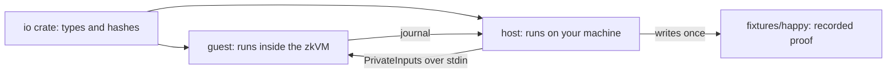

# Guest and Host Program Design

The zero-knowledge side uses [SP1](https://docs.succinct.xyz/), a zkVM: you write ordinary Rust, it compiles to RISC-V, and SP1 can prove that the program ran correctly on some hidden input. Three crates split the work.

## `zk-circuit/io`: one source of truth

Both sides must hash and lay out data the same way, or proofs fail for confusing reasons. So `io` owns:

- `PrivateInputs`: the witness the guest reads (shown with real values on [Tests](tests.md)).
- `PublicOutputs`: the journal the guest commits and the chain will read.
- Poseidon helpers: `compute_leaf`, `hash_nodes`, `verify_merkle_path`, `compute_nullifier`, and `index0_empty_path` for test trees.

The crate has no zkVM dependency, so it compiles natively and its unit tests run in CI in seconds. Poseidon (BN254, circom-compatible) is chosen because it is cheap inside proof systems, unlike SHA-256. Each 32-byte input is reduced into the BN254 scalar field (`x mod p`) before hashing, so Solana pubkeys and random secrets that sit above ~2^254 still hash. Happy-path toy bytes (`0x01…01`, `0x02…02`) are already in-field, so their leaves stay the same.

## `zk-circuit/guest`: the circuit

The guest is short. It reads `PrivateInputs`, enforces four rules, and commits the journal.

1. **Solvency**: `balance >= requested_swap_amount`, otherwise panic.
2. **Conservation**: `change_amount + spend == old balance` (`change_amount = balance - spend`). Fail closed if that identity does not hold.
3. **Membership**: recompute `leaf = Poseidon(secret, user_address, balance)`, then hash up the 20-level path to a root. It must equal `expected_root`, otherwise panic.
4. **Nullifier**: `Poseidon(secret, leaf, asset_id_mint)`.

If every check passes, the guest commits the journal, including a **change leaf** `Poseidon(secret, user_address, change_amount)` when the remainder is non-zero. If any check fails, the guest panics, and a panicked run cannot produce a valid proof. That is what "fail closed" means here.

Fixed-size arrays everywhere (`[u8; 32]`, a `[_; 20]` path) keep the guest free of heap allocation, which keeps the cycle count down.

## The journal: what the chain will see

The committed happy-path Groth16 fixture is **144 bytes** (spend 100, change 900). Spend-all still encodes **104 bytes** (`change_amount = 0`). There is no recipient pubkey in it yet.

| Bytes | Field | Type |
| --- | --- | --- |
| 0..8 | `requested_swap_amount` | little-endian `u64` |
| 8..40 | `asset_id_mint` | 32 bytes |
| 40..72 | `nullifier` | 32 bytes |
| 72..104 | `merkle_root` | 32 bytes |
| 104..112 | `change_amount` | little-endian `u64` (144-byte journals only) |
| 112..144 | `change_leaf` | 32 bytes (144-byte journals only) |

`PublicOutputs::from_journal_bytes` accepts 104 or 144 bytes and rejects any other length. A 144-byte journal with `change_amount > 0` and an all-zero `change_leaf` is rejected. Groth16 public inputs **are** those journal bytes (hashed), so a 104-byte proof cannot verify a 144-byte journal. The current guest `vk.bytes32()` is `0x00435696…c240` (CI pack and Devnet `GlobalConfig`). A live wrap still needs a journal mint that matches the vault.

## `zk-circuit/host`: the driver

The host builds `PrivateInputs`, hands them to the guest over SP1 stdin, and reads back the journal. It has two modes:

| Mode | What runs | Cost | How |
| --- | --- | --- | --- |
| **Execute** (default) | Guest runs in the zkVM, no proof | Free, local | `cargo run -p zk-circuit-host --release` |
| **Remote Groth16** | Succinct prover network produces a proof | Paid in `$PROVE` | `--features network` plus env flags |

A Groth16 wrap needs more memory than a typical laptop has, so real proofs go to the Succinct network. The `network` Cargo feature is off by default. It pulls in a large dependency tree that only the remote path needs.

## Fixtures: prove once, test forever

Remote proofs of the same toy happy-path input:

| Pack | Journal | `vk.bytes32()` | Use |
| --- | --- | --- | --- |
| `zk-circuit/fixtures/happy/` | 144 bytes | `0x00435696...c240` | CI Groth16 / `VKEY_HASH` (spend 100 / change 900) |
| Live wrap (`sp1-artifacts/`, gitignored) | 104 or 144 | same `0x00435696...c240` (same ELF) | Devnet settle; journal mint must match the vault |

Each pack has `groth16.bin` (356 bytes), `journal.bin`, and `vkey.bytes32.txt`. Tests read these bytes instead of proving again. That keeps CI offline, free, and deterministic. The bytes come from toy test values, not real funds.

Live wraps (`WITNESS_JSON` + `ARTIFACT_DIR`) must not overwrite `fixtures/happy/`. Omit `leaves_hex` for a one-leaf tree. Pass `leaves_hex` + `leaf_index` when the tree has more than one leaf (second deposit or a change note).
