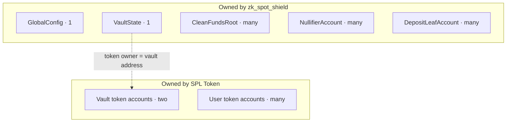
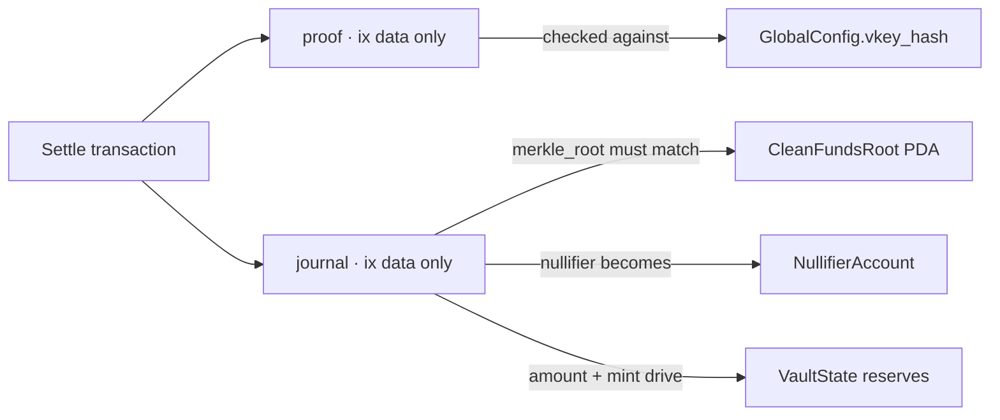

# Solana Program

The on-chain crate is `programs/zk_spot_shield/` (`zk_spot_shield`). It owns config, vault accounting, deposit leaves, approved Merkle roots, and spent nullifiers. Settlement verifies a Groth16 proof and moves tokens.

Terms (owner vs payer vs protocol admin): [Glossary](glossary.md). Numbered journey: [Architecture](architecture.md).

## Accounts

Every Anchor account also carries an 8-byte type tag, so allocations are `8 + size`. Rent space, proof/journal lengths, and CU live in [`notes/budgets.md`](https://github.com/pprogrammingg/zk-spot-shield/blob/main/notes/budgets.md).

| Piece | Kind | Seeds | Data | Purpose |
| --- | --- | --- | --- | --- |
| `GlobalConfig` | Borsh `Account` | `["global-config"]` | 65 B | Admin key, trusted circuit fingerprint, pause |
| `VaultState` | zero-copy | `["spot_vault"]` | 120 B | Pair mints, reserve counters, PDA bump |
| Vault token ATAs | SPL | Associated-token; **owner** = vault PDA | n/a | Real mint A / mint B balances |
| `DepositLeafAccount` | zero-copy | `["deposit_leaf", leaf]` | 104 B | Public commitment + amount / mint / depositor |
| `CleanFundsRoot` | zero-copy | `["clean_funds_root", root]` | 32 B | One account per approved Merkle root |
| `NullifierAccount` | zero-copy | `["nullifier", nullifier]` | 32 B | One account per spent nullifier |

`GlobalConfig` is small and rarely written (`Account<T>`). `VaultState` is hot-path (`AccountLoader`, `#[repr(C)]`, `_padding` after `bump` at byte 113).

The **bump** lets the program `invoke_signed` as the vault PDA for token payouts. The **protocol admin** on config signs pause / register / vkey rotate — not SPL payouts. Anchor `has_one = authority` gates those admin instructions.

Deposit leaf PDAs are unique (`init` fails on replay). Account data stores the public leaf plus amount, mint, and **depositor**, so deposit privacy is imperfect today. Nullifier seeds omit the wallet so the spend-tag address does not dox the user. Existence = already spent. `CleanFundsRoot` uses the same existence pattern for approved tree tips so in-flight proofs against older registered roots can still settle.

## Instruction data vs durable state

`settle_shielded_spot(ctx, proof, journal)` takes **proof** and **journal** as instruction arguments. They are not fields on `VaultState`. After success the chain keeps updated reserves, SPL balances, and a new nullifier PDA — not a copy of the Groth16 bytes.

Each instruction declares **only the accounts that call needs**. Solana only passes the working set named in the transaction.

## Instructions

| Bucket | Instruction | Role |
| --- | --- | --- |
| Admin | `initialize_global_config` | Create config PDA; write initial `vkey_hash`; set protocol admin |
| Admin | `initialize_vault` | Create `VaultState` PDA (mints default, zero reserves, bump) |
| Admin | `set_vault_mints` | Protocol admin writes `mint_a` / `mint_b` once |
| Admin | `set_vkey_hash` | Protocol admin rotates `vkey_hash` after a guest rebuild |
| Admin | `register_clean_funds_root` | Protocol admin allow-lists a Merkle root PDA |
| Admin | `pause` / `unpause` | Protocol admin toggles `pause_flag` |
| Deposit | `deposit_shielded` | CPI: user ATA → vault ATA; `init` leaf PDA; bump reserves |
| Spend | `settle_shielded_spot` | Verify proof + journal; check root; vault-only payout of the other mint; create nullifier |

SDK and UI call these same instructions. Default settle uses the committed happy-path fixtures.

### Settle today (vault-only 1:1)

1. Reject if paused.
2. Verify Groth16 against `GlobalConfig.vkey_hash`.
3. Require journal `merkle_root` to match an existing `CleanFundsRoot`.
4. Require nullifier PDA empty.
5. `apply_vault_only_spend` on `VaultState` reserves (same `amount` both sides).
6. SPL: vault PDA pays the **other** mint to the recipient. No second user→vault of the journal mint (deposit already funded custody).
7. Create `NullifierAccount`.

The fee payer may be a relayer; it need not own the recipient token accounts.

Upcoming: change notes for leftovers; full hidden recipient; encrypted note backup. See [Architecture](architecture.md) phase E.

Errors map to checks: `InvalidProof`, `MerkleRootNotFound`, `NullifierAlreadyUsed`, `ProtocolPaused`, token/vault errors, and zero-copy failures.

## Scenarios

### Happy path

Deposit, admin registers the tree tip, then a settle with a valid proof succeeds. After deposit, mint A sits in the vault. Settle is vault-only: the vault pays the other mint 1:1.

| Account | Role |
| --- | --- |
| `GlobalConfig` | Pause off; `vkey_hash` used to verify. Proof is only in the settle instruction. |
| `VaultState` | Reserves updated 1:1. Journal amount/mint are instruction bytes. |
| Vault token accounts | Deposit already moved custody in; settle pays the other mint out. |
| `CleanFundsRoot` | Must already exist for the journal’s Merkle root. |
| `DepositLeafAccount` | Created at deposit (leaf / amount / mint / **depositor**). |
| `NullifierAccount` | Created at the end of settle from the journal nullifier. |
| Recipient token accounts | Receive the other mint; owner need not be the fee payer. |

### Pause

Admin sets `pause_flag`. Settles fail closed (`ProtocolPaused`) until unpaused. Vault reserves are unchanged. Registering a new root still needs the admin.

### Fail closed

| Attack | What the chain does |
| --- | --- |
| Replay the same spend | Second settle sees a non-empty nullifier PDA → `NullifierAlreadyUsed` |
| Cite an unknown Merkle root | `MerkleRootNotFound` or missing PDA |
| Pause, register, or set vault mints without protocol admin | `Unauthorized` via `has_one = authority` |
| Wrong token accounts | `InvalidTokenAccount` |
| Garbage or wrong-circuit proof | `InvalidProof` — bytes never land in the vault |
| Vault cannot pay the other mint | `VaultReserveUnderflow`; no nullifier created |
| Note balance too low in the circuit | Guest fails closed → no proof to submit |

Native unit tests cover sizes, padding offsets, seed uniqueness, PDA stability, and who must sign each of the nine instructions. LiteSVM tests exercise initialize, `set_vault_mints`, `set_vkey_hash`, deposit, and vault-only settle against a real `.so`.
